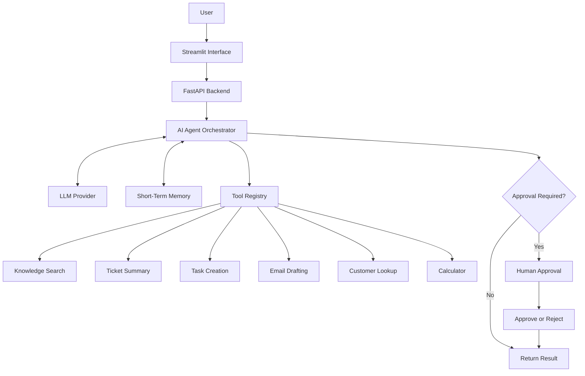

# AI Operations Agent

**Intelligent Business Workflow Automation | FastAPI · LLMs · Tool Calling · Human-in-the-Loop**

AI Operations Agent is an AI-powered business operations assistant designed to automate routine internal workflows, streamline information retrieval, and support operational decision-making.

Unlike traditional chatbots, the system can interpret requests, select and execute registered tools, interact with company data, and coordinate multi-step tasks while requiring human approval for sensitive operations.

The project demonstrates a modular approach to building AI agents with controlled automation, transparent execution, and human oversight.

## Overview

Small businesses often manage support tickets, customer records, internal policies, and operational tasks across multiple disconnected processes.

AI Operations Agent brings these workflows together through a conversational interface, allowing users to interact with business information and operational tools using natural language.

The system focuses on three principles:

- **Intelligent Automation:** Use LLM-driven tool selection to complete operational tasks.
- **Human Oversight:** Require approval before executing sensitive actions.
- **Modular Design:** Separate AI orchestration, business tools, API services, and data management.

## Key Features

| Feature | Description |
|---|---|
| AI Agent Orchestration | Interprets requests and coordinates multi-step workflows using LLM-driven tool selection. |
| Tool Calling | Executes predefined business tools through a controlled tool registry. |
| Knowledge Search | Retrieves information from local company policies and documentation. |
| Ticket Management | Retrieves and summarizes support tickets stored in SQLite. |
| Task Automation | Creates operational tasks with approval requirements for high-priority actions. |
| Email Drafting | Generates customer-facing email drafts for human review. |
| Customer Lookup | Retrieves customer information with sensitive data redacted by default. |
| Human-in-the-Loop | Supports approval and rejection of sensitive operations. |
| Conversation Memory | Maintains configurable short-term context within active sessions. |
| Interactive Dashboard | Provides a Streamlit interface for conversations and pending approvals. |
| Multiple LLM Providers | Supports Groq, OpenAI-compatible APIs, and Ollama through configuration. |

## Technology Stack

| Component | Technology |
|---|---|
| Programming Language | Python |
| Backend Framework | FastAPI |
| User Interface | Streamlit |
| AI Integration | LLM APIs |
| Supported Providers | Groq, OpenAI, Ollama |
| Agent Orchestration | Custom Python Orchestrator |
| Tool Execution | Structured Tool Registry |
| Database | SQLite |
| Data Validation | Pydantic |
| Knowledge Base | Markdown Documents |
| Containerization | Docker, Docker Compose |
| Testing | Pytest |

## System Architecture

The application follows a modular architecture where the language model determines the next action, while the backend controls which tools can execute.



The orchestrator limits execution to registered tools and applies approval policies before sensitive operations proceed.

## Available Business Tools

The application currently includes six operational tools:

| Tool | Function | Approval |
|---|---|---|
| Knowledge Search | Search company policies and internal documentation. | Not required |
| Ticket Summary | Retrieve and summarize support tickets. | Not required |
| Calculator | Perform validated arithmetic operations. | Not required |
| Email Draft | Generate customer email drafts. | Required |
| Task Creator | Create operational tasks. | Required for high-priority tasks |
| Customer Lookup | Retrieve customer information with configurable redaction. | Required for full access |

Email drafting does not send emails automatically. Approval authorizes the relevant stored action or review workflow, depending on the tool.

## Human-in-the-Loop Workflow

Sensitive operations are handled through an explicit approval process.

1. The agent identifies an action requiring human authorization.
2. The backend creates a pending approval record.
3. The action appears in the Streamlit dashboard.
4. An operator approves or rejects the request.
5. Approved actions are processed according to the defined tool policy.
6. The decision and execution result are recorded.

This mechanism provides an additional layer of control over actions involving customer information, external communications, or high-priority tasks.

## Quick Start

### Requirements

- Python 3.11+
- pip
- A configured LLM provider
- Docker and Docker Compose (optional)

### Installation

```bash
git clone <repository-url>
cd ai-operations-agent

python -m venv .venv
```

Activate the virtual environment and install dependencies:

```bash
pip install -r requirements.txt
```

Create an environment configuration file from `.env.example` and configure the selected LLM provider.

Initialize the database:

```bash
python -m app.db.seed
```

Start the FastAPI backend:

```bash
uvicorn app.api.main:app --reload --host 127.0.0.1 --port 8000
```

Start the Streamlit interface in a separate terminal:

```bash
streamlit run ui/streamlit_app.py
```

Access the application:

- **Dashboard:** `http://localhost:8501`
- **API Documentation:** `http://localhost:8000/docs`

### Docker

The project also supports Docker Compose for local deployment:

```bash
docker compose up --build
```

## Example Use Cases

The agent supports natural-language requests such as:

```text
Summarize all open high-priority support tickets.

Search the company refund policy for damaged products.

Create a high-priority task to escalate ticket 102.

Draft a customer email regarding a delayed shipment.

Look up the customer record for Delta Logistics.
```

Depending on the requested action and configured policies, the agent may return information, execute a registered tool, or request human approval.

## Security & Reliability

The implementation includes several controls designed to support safer agent execution:

- Registered-tool-only execution.
- Structured input validation using Pydantic.
- Human approval for sensitive operations.
- Customer data redaction by default.
- Safe arithmetic evaluation without unrestricted `eval`.
- Action logging for approval decisions.
- Environment-based API credential configuration.
- Configurable agent iteration limits.

## Current Limitations

The project is a reference implementation intended for development, demonstration, and further customization.

Current limitations include:

- Short-term conversation memory is not persistent across server restarts.
- Knowledge retrieval uses keyword-based search rather than vector embeddings.
- Email drafts are generated but not automatically sent.
- User authentication and role-based approvals are not implemented.
- Production-grade security controls and data governance require additional development.

## Future Improvements

Potential enhancements include:

- Authentication and role-based access control.
- Vector-based knowledge retrieval.
- Persistent conversation memory.
- LangGraph-based orchestration.
- External business system integrations.
- Improved observability and audit reporting.

## Testing

The project includes automated tests covering tool registration, database initialization, approval workflows, input validation, and agent response structures.

Run the test suite:

```bash
pytest -q
```

## Project Information

**Project:** AI Operations Agent

**Category:** Agentic AI / Business Process Automation

**Developer:** Seif Eldeen Hassan

**Purpose:** Demonstrating controlled AI-driven workflow automation for internal business operations.
