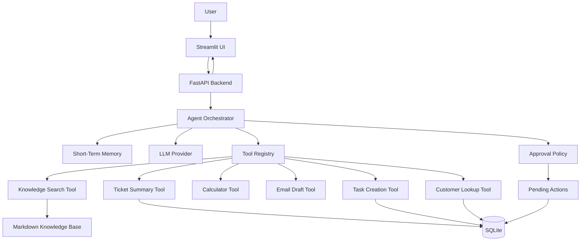
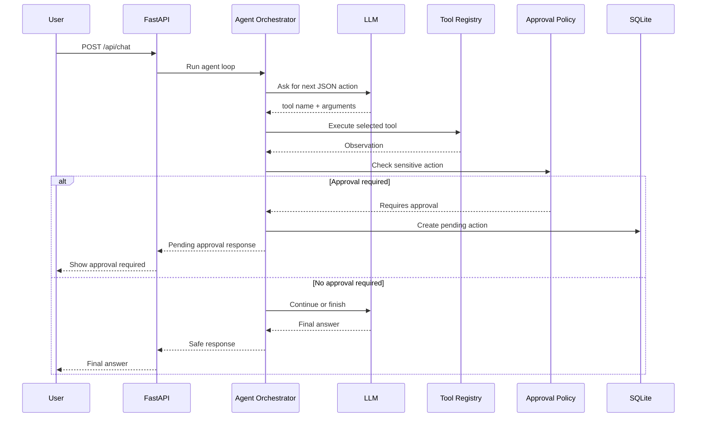
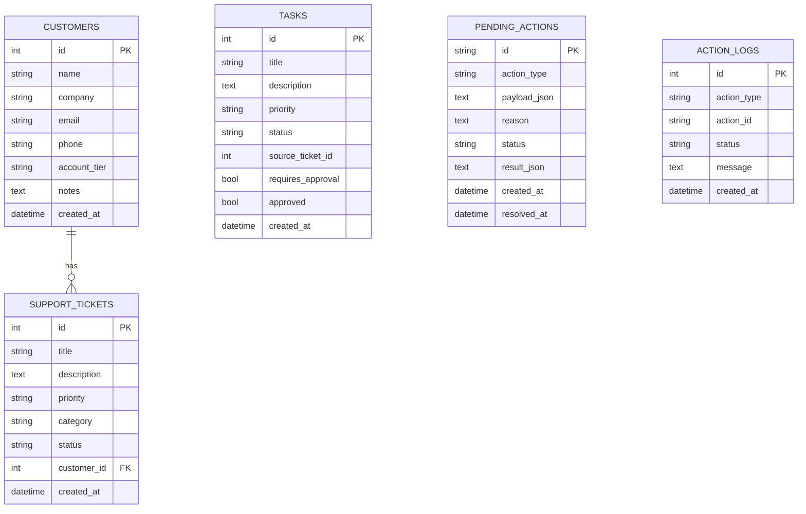

# AI Operations Agent

A practical, portfolio-quality AI agent project that can understand an operations request, choose tools, execute multi-step workflows, maintain short-term memory, and pause for human approval before sensitive actions.

This project is intentionally built as a clear reference implementation. It is not a toy script that only prints text. The agent calls real tools, reads and writes a local SQLite database, searches Markdown files, creates approval records, and exposes a FastAPI backend with a Streamlit UI.

---

## 1. Project Overview

**AI Operations Agent** is an AI operations assistant for a small company. It helps with common internal workflows such as:

- Searching company policy documents
- Summarizing open support tickets
- Creating operational task plans
- Drafting customer emails
- Running safe calculations
- Looking up customers with sensitive fields redacted
- Pausing before actions that require human approval

The project demonstrates core agentic AI concepts in a way that is understandable for beginners and professional enough for a GitHub portfolio.

---

## 2. Problem Statement

Small companies often handle support, billing, shipping, refunds, and customer follow-ups across disconnected systems. A normal chatbot can answer questions, but it usually cannot safely interact with operational tools.

This project solves that problem by building an AI agent that can:

1. Interpret the user request.
2. Select the correct tool.
3. Execute the tool.
4. Observe the result.
5. Continue the workflow if needed.
6. Pause when human approval is required.
7. Return a safe final answer.

The goal is not full automation at any cost. The goal is **controlled automation** with clear safety boundaries.

---

## 3. What Is an AI Agent?

An AI agent is a system that uses an LLM to decide what action to take next. Instead of only generating text, the agent can call tools, inspect results, and continue working toward a goal.

In this project, the agent follows a simple loop:

1. Receive a user request.
2. Ask the LLM to choose the next step in structured JSON.
3. Execute the selected tool through a tool registry.
4. Observe the result.
5. Continue or finish.
6. Stop at the approval gate for sensitive actions.

---

## 4. Chatbot vs Agent

| Capability | Basic Chatbot | AI Operations Agent |
|---|---|---|
| Generates text | Yes | Yes |
| Calls tools | Usually no | Yes |
| Reads a database | No | Yes |
| Writes a database | No | Yes, with approval rules |
| Searches local company docs | Usually no | Yes |
| Maintains short-term context | Sometimes | Yes, configurable last N messages |
| Human approval gate | Usually no | Yes |
| Structured tool outputs | No | Yes |

A chatbot mainly responds. An agent can perform controlled actions.

---

## 5. What This Project Demonstrates

### Tool Use

The agent can call tools for search, ticket summaries, arithmetic, email drafting, task creation, and customer lookup.

### Orchestration

The backend implements an agent loop in `app/agent/orchestrator.py`. The LLM chooses the next step, and the backend executes only registered tools.

### Memory

The project includes short-term conversation memory in `app/agent/memory.py`. It stores the last N messages per session. N is configurable with `AI_OPS_MEMORY_WINDOW`.

This is **not long-term memory**. It is in-process memory and resets when the server restarts.

### Human-in-the-Loop

Sensitive actions create pending approval records. The UI shows approve and reject buttons.

### Safety Policies

The approval policy lives in `app/agent/policy.py`. It marks sensitive operations such as high-priority task creation, external email drafts, and customer record access.

### Structured Tool Outputs

Tools return a consistent `ToolResult` object with success status, message, data, approval status, action type, and action payload.

---

## 6. Architecture Diagram



---

## 7. Agent Workflow Diagram



---

## 8. Tool List

| Tool | File | Purpose | Approval Required? |
|---|---|---|---|
| Knowledge Search | `app/tools/knowledge_search.py` | Searches local Markdown company docs | No |
| Ticket Summary | `app/tools/ticket_summary.py` | Summarizes open tickets from SQLite | No |
| Calculator | `app/tools/calculator.py` | Safely evaluates basic arithmetic | No |
| Email Draft | `app/tools/email_draft.py` | Creates an external email draft | Yes |
| Task Creator | `app/tools/task_creator.py` | Creates tasks in SQLite | Only high priority |
| Customer Lookup | `app/tools/customer_lookup.py` | Looks up customers with redaction | Yes for full access |

---

## 9. Human Approval Workflow

Sensitive operations do not execute silently.

Sensitive actions include:

- Creating high-priority tasks
- Generating external email drafts
- Accessing customer records

When the agent triggers a sensitive action:

1. The tool returns `requires_approval=True`.
2. The orchestrator creates a row in `pending_actions`.
3. The chat response tells the user approval is required.
4. The Streamlit UI displays the pending action and reason.
5. A human can approve or reject it.
6. Approval executes the stored action payload when applicable.
7. Rejection prevents execution.

Email drafts are never sent by this project. Approval only marks the draft as reviewed for human use.

---

## 10. Database Schema

SQLite is used for local development.



---

## 11. Repository Structure

```text
ai-operations-agent/
├── app/
│   ├── api/
│   │   ├── main.py
│   │   └── routes.py
│   ├── agent/
│   │   ├── orchestrator.py
│   │   ├── memory.py
│   │   ├── prompts.py
│   │   ├── llm.py
│   │   └── policy.py
│   ├── tools/
│   │   ├── registry.py
│   │   ├── calculator.py
│   │   ├── knowledge_search.py
│   │   ├── ticket_summary.py
│   │   ├── email_draft.py
│   │   ├── task_creator.py
│   │   └── customer_lookup.py
│   ├── db/
│   │   ├── database.py
│   │   ├── models.py
│   │   └── seed.py
│   ├── schemas/
│   │   └── models.py
│   └── core/
│       └── config.py
├── ui/
│   └── streamlit_app.py
├── knowledge_base/
│   ├── company_policy.md
│   ├── refund_policy.md
│   └── escalation_guide.md
├── tests/
├── docker-compose.yml
├── Dockerfile
├── Makefile
├── requirements.txt
├── .env.example
├── .gitignore
└── README.md
```

---

## 12. Setup Instructions

### Prerequisites

- Python 3.11+
- pip
- Optional: Docker and Docker Compose
- Optional: Ollama for local LLMs

### Clone and Install

```bash
git clone https://github.com/your-username/ai-operations-agent.git
cd ai-operations-agent
python -m venv .venv
source .venv/bin/activate  # macOS/Linux
# .venv\Scripts\activate   # Windows
pip install -r requirements.txt
```

### Create Environment File

```bash
cp .env.example .env
```

Edit `.env` and configure one LLM provider.

---

## 13. `.env` Explanation

All app settings use the `AI_OPS_` prefix.

| Variable | Purpose |
|---|---|
| `AI_OPS_DATABASE_URL` | SQLite database path |
| `AI_OPS_KNOWLEDGE_BASE_DIR` | Local Markdown knowledge base path |
| `AI_OPS_MEMORY_WINDOW` | Number of recent messages stored per session |
| `AI_OPS_MAX_AGENT_STEPS` | Maximum tool loop iterations |
| `AI_OPS_LLM_PROVIDER` | `openai`, `groq`, or `ollama` |
| `AI_OPS_OPENAI_API_KEY` | OpenAI API key if using OpenAI |
| `AI_OPS_OPENAI_BASE_URL` | OpenAI-compatible base URL |
| `AI_OPS_OPENAI_MODEL` | OpenAI model name |
| `AI_OPS_GROQ_API_KEY` | Groq API key |
| `AI_OPS_GROQ_MODEL` | Groq model name |
| `AI_OPS_OLLAMA_BASE_URL` | Ollama local server URL |
| `AI_OPS_OLLAMA_MODEL` | Ollama model name |
| `AI_OPS_API_BASE_URL` | Backend URL used by Streamlit |

No API keys are hardcoded in the source code.

---

## 14. How to Run the API

Initialize and seed the database:

```bash
python -m app.db.seed
```

Run FastAPI:

```bash
uvicorn app.api.main:app --reload --host 0.0.0.0 --port 8000
```

Open the API docs:

```text
http://localhost:8000/docs
```

Health check:

```bash
curl http://localhost:8000/health
```

---

## 15. How to Run the UI

In another terminal:

```bash
streamlit run ui/streamlit_app.py
```

Then open:

```text
http://localhost:8501
```

---

## 16. Docker Compose

```bash
docker compose up --build
```

Services:

- FastAPI: `http://localhost:8000`
- Streamlit: `http://localhost:8501`

---

## 17. API Examples

### Health

```bash
curl http://localhost:8000/health
```

### Chat

```bash
curl -X POST http://localhost:8000/api/chat \
  -H "Content-Type: application/json" \
  -d '{"message":"Summarize open high-priority tickets","session_id":"demo"}'
```

### Pending Actions

```bash
curl http://localhost:8000/api/pending-actions
```

### Approve an Action

```bash
curl -X POST http://localhost:8000/api/approve/<action_id>
```

### Reject an Action

```bash
curl -X POST http://localhost:8000/api/reject/<action_id>
```

### Tools

```bash
curl http://localhost:8000/api/tools
```

### Tickets

```bash
curl http://localhost:8000/api/tickets
```

### Tasks

```bash
curl http://localhost:8000/api/tasks
```

---

## 18. Example User Prompts

Try these in the Streamlit chat UI:

```text
Summarize open high-priority tickets.
```

```text
Draft an email to Maya Johnson about a delayed order.
```

```text
Create a task to escalate ticket 102 with high priority.
```

```text
Search the refund policy for damaged items outside the normal refund window.
```

```text
Calculate 15% of 1240 plus 80.
```

```text
Look up customer Delta Logistics.
```

---

## 19. Testing Instructions

Run all tests:

```bash
pytest -q
```

The test suite covers:

- Tool registry
- Calculator safety
- Database seeding
- Approval workflow
- Sensitive action detection
- Chat response schema

---

## 20. Security and Safety Notes

This project includes several safety controls:

- No hardcoded API keys
- Pydantic request validation
- Registered-tool-only execution
- Safe calculator using Python AST instead of `eval`
- Approval gate for sensitive operations
- Action logs for approvals and rejections
- Customer email, phone, and notes redacted by default
- No private chain-of-thought shown in the UI
- Safe reasoning summaries are shown instead

This is still a demo project. Do not connect it to production systems without adding authentication, authorization, audit trails, rate limits, encryption, and stricter data governance.

---

## 21. Limitations

- Short-term memory is in-process and resets when the server restarts.
- The knowledge search tool uses simple keyword scoring, not embeddings.
- Email drafting does not send emails.
- The UI is intentionally simple.
- The project does not include user authentication.
- Approval permissions are not role-based yet.
- No benchmark results are claimed.

---

## 22. Future Improvements

- Add authentication and role-based approvals
- Add vector search for the knowledge base
- Add LangGraph implementation option
- Add streaming chat responses
- Add persistent conversation storage
- Add structured audit log export
- Add Slack or email integration after approval
- Add task assignment and due dates
- Add observability with OpenTelemetry
- Add Docker volume for persistent SQLite data

---

## 23. How to Explain This Project in an Interview

This project demonstrates an AI agent that can use real tools, interact with a database, maintain short-term memory, and pause for human approval before sensitive operations. It is not just a chatbot; it performs controlled actions through a tool registry and approval policy.

A strong explanation:

> I built an AI Operations Agent for a small company scenario. The agent receives a user request, asks the LLM to choose the next action in structured JSON, executes only registered tools, observes the result, and either continues or returns a final answer. The project includes tools for knowledge search, ticket summaries, safe calculations, email drafts, task creation, and customer lookup. Sensitive operations such as high-priority task creation, external email drafts, and customer record access are stopped by a human approval gate. The UI shows pending actions with approve and reject buttons. I also added short-term memory, Pydantic schemas, SQLite seed data, action logs, and tests for safety-critical parts.

### Interview Talking Points

- The agent uses an explicit tool registry, so it cannot call arbitrary functions.
- The calculator uses AST parsing instead of unsafe `eval`.
- Customer data is redacted unless approval is granted.
- High-priority task creation is not executed until approved.
- Email drafts are generated but never sent.
- The system displays reasoning summaries, not hidden chain-of-thought.
- The architecture separates API, agent logic, tools, database, schemas, and UI.
- The app supports OpenAI-compatible APIs, Groq, and Ollama through `.env` configuration.
- The project is designed for clear demonstration rather than fake benchmark claims.

---

## 24. License

Use this project as a learning and portfolio reference. Add your preferred license before publishing publicly.
